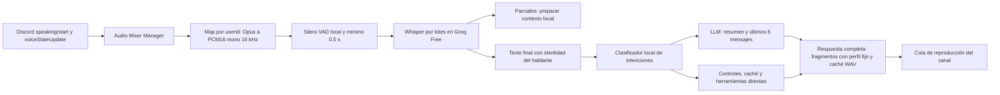

# TARS

Asistente de Discord por texto y voz inspirado en Interstellar. Node 24,
JavaScript/CommonJS y un módulo TypeScript ejecutado directamente por Node.
Docker instala ffmpeg, Piper y Silero VAD. Una instancia por token;
atiende un canal de voz a la vez. Este repositorio no implementa TeamSpeak.

La configuración gratuita y el diagnóstico de consistencia están en
[VOICE.md](VOICE.md). Se usa únicamente Piper es_MX-ald medium y Groq Free;
Deepgram se rechaza y no existe fallback a eSpeak. Los WAV habituales se
pregeneran en el PC con `npm run voice:pregenerate` y se incluyen en Docker.

## Arquitectura de voz global



Discord requiere `receiver.subscribe(userId)`; no tiene una suscripción sin usuario.
`src/voice/audioMixerManager.js` coordina suscripciones al conectar, al entrar alguien
 y en `receiver.speaking.on('start')`. Deduplica suscripciones e ignora bots.
Conserva PCM independiente en `Map<userId, Buffer[]>`; no suma señales. La diarización
usa la identidad conocida por Discord: `[Usuario: Nombre] dijo: "texto"`, asociada
internamente al ID. No identifica personas distintas compartiendo una cuenta.

Silero mediante `sherpa-onnx-node` filtra antes de STT; no es solo un umbral de
energía. Descarta silencio, ruido rechazado por VAD e intervenciones con menos de
0.5 segundos detectados. Conserva hasta 200 ms de inicio para no cortar consonantes;
el cierre local espera 650 ms desde la última trama detectada como voz. El modelo
además tiene su propio margen de detección. PCM solo vive en RAM.

Límites: 100 suscripciones, 12 segundos por intervención, 8 conexiones STT simultáneas,
8 trabajos pendientes y 16 fragmentos TTS en cola. Bajo sobrecarga se descartan
intervenciones; preguntas con más de 15 segundos en espera caducan. Una transmisión
continua se divide en segmentos. La salida se serializa para evitar respuestas
superpuestas. Salir libera decodificadores, VAD, temporizadores y sockets.

Durante reproducción se sigue recibiendo para detectar órdenes locales de salida.
Sin `TARS_ALLOW_BARGE_IN=true`, las demás intervenciones durante reproducción no
llegan al modelo. No hay cancelación de eco acústico; se recomiendan auriculares.
Siempre se ignoran los paquetes del propio bot. La transcripción existente conserva
sus cuotas; las órdenes no consumen tokens del modelo conversacional.

## Las tres capas

**A — local, sin tokens de LLM:** `src/optimization/lowLatencyPipeline.ts` reconoce
intenciones con regex ancladas. “TARS mute”, “desmuteate”, “deafen”, “deja de escuchar”,
“repite”, “sube/baja el volumen”, “estado”, “ayuda”, “resume lo que dijeron” y “humor 42”
se resuelven directamente. Mute, deafen y volumen afectan a TARS. La moderación por
voz remite a los comandos escritos existentes con menciones explícitas y permisos.

Con `TARS_WAKE_REQUIRED=true`, responde a TARS, preguntas directas, invocaciones
manuales o continuaciones del interlocutor durante 8 segundos. La detección de
preguntas es heurística: puede confundir preguntas entre participantes. Con `false`
responde a toda intervención aceptada. Este filtro funciona **después del STT**:
no evita enviar voz de fondo al proveedor. El detector acústico local de Hey TARS
sigue disponible en el modo anterior.

La caché acotada guarda saludos, agradecimientos e identidad durante 5 minutos,
aislados por canal/humor. No reutiliza respuestas personales ni preguntas contextuales.
“Cero tokens” se refiere al LLM; el STT puede tener coste.

**B — módulo incremental histórico, deshabilitado en el flujo gratuito:** `src/voice/deepgramStreaming.js` envía PCM por WebSocket
mientras se habla, después del umbral local de 0.5 segundos. Los parciales preparan
clasificación y contexto sin ejecutar acciones. Solo los resultados finales
confirmados provocan respuestas. Hay timeout, cancelación, límites de buffering y
reserva de presupuesto antes de abrir el socket. No duplica STT automáticamente
si falla el proveedor.

`TARS_STT_PROVIDER=groq` conserva Whisper por lotes para instalaciones existentes.
Ese modo espera el segmento completo y **no es streaming**. El módulo incremental
se conserva para no borrar trabajo previo, pero `createVoiceAudio` no lo conecta:
configurar Deepgram produce un error explícito antes de entrar al canal.

**C — modelo solo cuando hace falta:** obtiene la respuesta completa antes de
fragmentarla para Piper, con identidad y parámetros fijos. Cada WAV se valida antes
de reproducirse; si la síntesis falla, entrega la respuesta por texto. Texto y voz
tienen colas independientes. Se eliminó la separación
artificial de 10 segundos para voz; se mantienen presupuesto, cooldown y Retry-After.
Una respuesta que ya emitió frases no se reintenta en otro proveedor si falla.

`contextManager.js` separa memoria por `guildId:channelId`, conserva los últimos
6 mensajes (usuario o TARS) y crea un resumen extractivo local cada 20 mensajes,
sin llamadas adicionales al LLM. Recorta entradas, resumen y contexto enviado.
El resumen extractivo puede perder matices; no es síntesis semántica. El historial
de voz global no contamina el historial personal usado por `/tars`.

## Personalidad y patrones de Meta AI

`src/persona/sparkInspiredSystemPrompt.md` contiene Identity, Personality, Rules y
Tools. Humor inicial 75%, configurable con `TARS_HUMOR` y “TARS humor 42” durante
la sesión. Responde en 1–3 frases; amplía cuando se pide. El prompt se incluye una
vez por petición y no se guarda repetido en el historial. Cada cuarta respuesta del
modelo ofrece dos botones en el chat, sin leerlos. Caducan en 60 segundos; solo
puede usarlos el solicitante presente en el canal.

Meta describe Muse Spark como multimodal, contextual e integrado con Meta AI e
Instagram; no publica la arquitectura completa de sus DMs. Esto es una implementación
propia inspirada en patrones públicos, no una copia de pesos, prompts privados o
infraestructura. Fuentes:
[Meta](https://about.fb.com/news/2026/04/introducing-muse-spark-meta-superintelligence-labs/),
[Discord VoiceReceiver](https://discord.js.org/docs/packages/voice/main/VoiceReceiver:Class),
[Deepgram streaming](https://developers.deepgram.com/reference/speech-to-text/listen-streaming),
[Silero en sherpa-onnx](https://k2-fsa.github.io/sherpa/onnx/vad/silero-vad.html).

`search_web` y `generate_image` están preparadas como handlers inyectables en
`createVoice({ tools })`, resueltos por intención local sin razonamiento del modelo:

```js
tools: {
  search_web: async ({ query, signal, userId, channelKey }) => {
    // Conectar proveedor autorizado; devolver texto/URL del resultado.
  },
  generate_image: async ({ prompt, signal, userId, channelKey }) => {
    // Conectar proveedor autorizado; devolver texto/URL del resultado.
  },
}
```

Sin handlers, TARS dice que la herramienta no está configurada. No incluye proveedores
de búsqueda/imágenes ni simula ejecución. Los handlers deben propagar `signal`,
aplicar su presupuesto y devolver texto, limitado a 600 caracteres. Las URLs no se
leen en TTS.

## Privacidad y memoria

Al entrar TARS avisa que escucha a todo el canal y usa STT externo. También avisa a
nuevos participantes. Las exclusiones ya persistidas siguen aplicándose.
`/salir` detiene la recepción; `/reset` borra el historial de texto y la memoria
local de voz, incluso sin sesión. No elimina registros enviados a terceros.

`TARS_DATA_DIR/channelMemory.json` (por defecto `data/channelMemory.json`) guarda
usuarios frecuentes, gustos expresados como “me gusta…”, temas con “recuerda el
tema…” y bromas con “recuerda esta broma…”, además de exclusiones. No infiere gustos
ocultos. Escrituras serializadas y reemplazo atómico. Resumen y seis mensajes
recientes quedan en RAM; no se guardan transcripciones crudas en el JSON.
Hasta 100 canales, 50 usuarios frecuentes por canal, 5 gustos por usuario, 10 temas
y 10 bromas. El contexto enviado al LLM contiene estos datos como información no
confiable, nunca como instrucciones del sistema.

En modo global los logs de conversación en Discord están desactivados por defecto.
Con `TARS_VOICE_LOG_ENABLED=true`, las transcripciones aceptadas —incluida conversación
de fondo— y respuestas van a `logs-tars`, con autor/canal/hora y menciones deshabilitadas.
Los logs operativos no incluyen conversaciones, incluso con esa opción desactivada.
Configura acceso y retención de los registros.

## Configuración y compatibilidad

```sh
npm ci
node scripts/download-models.js --vad-only
npm test
```

`npm run models:download` descarga también los modelos anteriores; Docker lo hace
al construir. Descargas verificadas con SHA-256 fijado, incluido Silero. Si falta
VAD o es inválido, la entrada global falla; no usa silenciosamente un filtro de
energía. Configuración gratuita en el despliegue:

```dotenv
TARS_VOICE_ENABLED=true
TARS_GLOBAL_LISTENING=true
TARS_STT_PROVIDER=groq
TARS_WAKE_REQUIRED=true
TARS_HUMOR=75
TARS_ALLOW_BARGE_IN=false
TARS_VOICE_LOG_ENABLED=false
```

Configura también `DISCORD_TOKEN`, proveedor LLM (Groq o Cloudflare) y
`TARS_STATE_CHANNEL_ID` o `LOG_CHANNEL_ID` para cuotas. Mantén `.env` fuera de Git.
`TARS_DATA_DIR` debe ser un volumen persistente escribible para conservar recuerdos
y exclusiones entre despliegues. Docker crea `/app/data` para el usuario `node`,
pero un hosting con disco efímero puede borrarlo.

Se conservan `/entrar`, `/escuchar`, `/salir`, `/tars`, `/reset`, `/ping`, `/ayuda`,
`/resumir`, `/usuarios`, `/borrar` y variantes con `!`. `/escuchar` activa la próxima
pregunta sin wake word y reanuda escucha/voz. Sale tras 5 minutos sin invocaciones
aceptadas; la conversación de fondo no renueva el plazo.

`TARS_GLOBAL_LISTENING=false` conserva módulo y pruebas anteriores: captura manual
y detector acústico opcional `TARS_WAKE_ENABLED=true`, sin VAD global ni exclusiones
por usuario. `/salir` detiene la recepción.
`TARS_WAKE_ENABLED` solo afecta al modo anterior.

La moderación no cambia: `!borrar 10`, `!borrar @usuario 10` y `/borrar` aceptan 1–100;
más de 50 requiere confirmación del mismo solicitante. Exige Líder/Sigma y Gestionar
mensajes. Omite fijados, registros internos y mensajes de 14 días o más. Mute de
texto, apodos y expulsión de voz mantienen controles de permisos/jerarquía.
No se hicieron acciones de moderación reales durante las pruebas.

## Presupuesto y latencia

Límites internos por 24 horas móviles: 500 intentos, 100.000 tokens estimados,
3.600 segundos de audio, y 6 solicitudes/minuto para STT y otras 6 para LLM.
Los fallos también consumen reserva. Streaming STT reserva 12 segundos antes de
conectar; Whisper reserva al menos 10. El consumo informado por LLM ajusta reservas.
Si el stream termina antes de `usage`, se mantiene la estimación conservadora.
`[IA:saldo]` no representa el saldo facturable de una cuenta.

`[voz:latencia]` informa `fin_a_reproduccion_ms`: desde la última trama detectada como
voz hasta `AudioPlayerStatus.Playing` de la primera frase. Incluye cierre VAD, STT,
cola, primer texto, síntesis y arranque del reproductor. Es una aproximación en el
servidor: no mide cuándo escucha el cliente Discord. Solo respuestas que comienzan
a reproducirse generan muestra; revisa también errores y sobrecarga. `cumple` exige
<800 ms. Para resumir registros exportados:

```sh
node scripts/voice-latency.js ruta/al/registro.log
```

El objetivo **<800 ms no está demostrado en producción**. Las pruebas usan dobles
de Discord, STT y LLM para verificar orden/concurrencia, no rendimiento del servicio.
Prueba una y varias personas, modelos fríos/calientes, ambas rutas STT y eco;
compara p50/p95 y errores. Streaming y modelos calientes reducen trabajo tras el
fin del habla, pero red, CPU, cuotas y cola pueden superar el objetivo. No se
garantiza ese tiempo con Whisper por lotes ni hosting gratuito suspendido.

Diagnóstico: `[voz:error]`, `[voz:latencia]`, `[voz:memoria]`, `[IA:limite]` y
`[IA:saldo]`. Los nuevos diagnósticos técnicos no contienen transcripciones ni claves.
Pruebas: hablantes simultáneos, bots, VAD/0.5 s, privacidad, cancelación, controles
sin LLM, contexto aislado, persistencia, SSE fragmentado, texto parcial/final,
presupuesto y compatibilidad anterior. Los tests SSE cubren el módulo histórico;
la ruta gratuita actual espera el texto completo antes de reproducirlo.

## Salida hablada, cuenta regresiva y logs operativos

Di “TARS, salte”, “TARS, puedes irte” o “TARS, desconéctate”. Se aceptan cortesías,
tildes y puntuación. Negaciones y menciones narrativas no ejecutan acciones.
“TARS, autodestrucción” reproduce 5, 4, 3, 2, 1 y sale a los cinco segundos.
Repetirla no reinicia el plazo; una salida normal lo interrumpe inmediatamente.
El WAV pregenerado usa el perfil de voz de TARS: `npm run voice:pregenerate`.
No se sintetiza durante la ejecución de la orden. Un fallo de audio no cancela la salida.
El bot conserva el límite existente de una sesión de voz a la vez; eventos de
otros servidores no la cierran. En modo manual, las órdenes usan la captura
activada por /escuchar o Hey TARS; durante respuestas se habilita recepción de controles.

`LOG_CHANNEL_ID` tiene prioridad para logs operativos. Sin él se busca el canal
existente `logs-tars` del servidor del evento (caché y fetch). No se crean canales.
Para eventos globales se requiere un destino inequívoco; configura el ID si hay varios.
El bot necesita Ver canal y Enviar mensajes (Enviar mensajes en hilos si corresponde).
La cola admite 100 registros, separa envíos por 1,1 s y reintenta como máximo dos
veces ante 429/5xx. Discord.js gestiona sus límites REST. Un error de red ambiguo
no se reenvía, para evitar duplicados. Los fallos dejan diagnóstico en consola.
Los registros incluyen fecha UTC, evento, contexto disponible, resultado y error;
se omiten mensajes, respuestas y secretos. Los mensajes de bots no ejecutan comandos.

## Diagnóstico de pausas y nueva voz

El aviso AI_BUDGET con reason=requests_minute era un límite interno, independiente
del saldo diario de tokens. La escucha global puede gastar transcripciones sin
producir respuestas. Ahora el arranque configura 20 STT/min y 6 LLM/min; son topes
locales ajustables con TARS_STT_REQUESTS_PER_MINUTE y TARS_LLM_REQUESTS_PER_MINUTE
(1–60). Se conservan los topes diarios, el registro persistente y los 429 del proveedor.
Los avisos indican servicio, motivo y segundos de espera; no se reinician cuotas.

TARS_VAD_ENDPOINT_MS=650 agrupa pausas cortas para evitar fragmentar una frase.
Un límite de LLM invalida trabajo pendiente pero mantiene STT y órdenes locales.
Un límite de STT sí impide reconocer voz hasta recuperarse: /salir sigue funcionando.
La cola admite tres turnos; preguntas nuevas del mismo usuario sustituyen turnos
suyos todavía sin iniciar. Respuestas con más de 15 s se entregan por texto en lugar
de reproducir audio atrasado. Se registran tiempos STT, cola, modelo, síntesis y
espera de persistencia de cuotas; el total antiguo no permitía atribuir la demora.

Los logs muestran evento, usuario, nombre enlazado del canal, hora de Discord y
resultado. El nombre explícito evita depender de una mención que aparezca como
canal desconocido. Las transcripciones siguen siendo opt-in; el cambio de diseño
no activa la publicación de conversaciones.

La voz usa ahora Ald (español mexicano), con tono ajustado a 0,84 y velocidad de
síntesis 1,12. Todos los WAV se regeneraron; la clave de caché cambia con el perfil.
El modelo se descarga al construir Docker y se verifica con SHA-256. Incluye una
muestra en audio/tars-ald-grave-demo.wav. La cuenta regresiva tiene cinco segundos
exactos; sus números se sintetizan más rápido únicamente durante la pregeneración.
